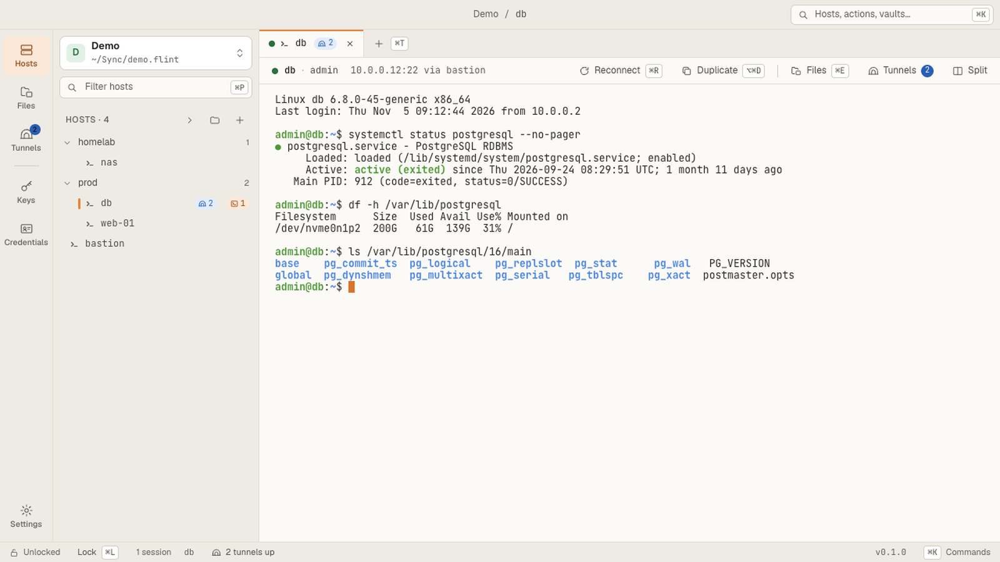

<h1 align="center">Flint</h1>

<p align="center">
  A light SSH and RDP client with a desktop app and a CLI over one fully encrypted vault.<br>
  Reach your servers by alias, from a window, a terminal or an AI agent, without exposing a credential.
</p>

<p align="center">
  
  
  
  
</p>

<picture>
  <source media="(prefers-color-scheme: dark)" srcset="site/src/assets/video/app-dark-desktop.png">
  
</picture>

> [!WARNING]
> **Preview.** Flint is in early development. It works today on macOS and Linux (Windows
> is in progress), but there are no release builds yet: you
> [build it from source](site/src/content/docs/start/build-from-source.md). The vault
> format may still change between versions.

## Why Flint

Good SSH clients tend to be Windows only, ugly, slow, or keep sync behind a subscription.
Flint aims to be one free, fast, good-looking client for SSH and RDP on every desktop,
with nothing behind a paywall.

- **The whole vault is encrypted.** Hostnames, users, labels and known host keys too, not
  only passwords (SQLCipher, AES-256; secrets sealed again with XChaCha20-Poly1305, the key
  from Argon2id). Keep it in a cloud folder, or sync it through a server you run yourself.
- **One vault, two ways in.** The desktop app and the `flint` CLI are two front ends over
  the same core and the same file. A host added in one shows up in the other.
- **Built for scripts and AI agents.** Every command takes `--json` and has stable exit
  codes. An agent runs `flint exec web-01 -- uptime` and gets the output, never a password
  or a key, and only for what you have allowed.
- **Flint holds the unlocked vault.** The key lives in the running app, which locks on its
  own when you step away. The CLI and your agents ask it; nothing caches the key.

## What it does

| | |
|---|---|
| **Terminal** | Tabs that split into up to four panes, xterm.js with the Kitty keyboard protocol, OSC 52 copy, images pasted onto the server, a command palette, a host tree with nested groups |
| **Connections** | Password, key and agent logins, jump hosts by alias, host key verification, an initial command per host (`tmux`, `herdr`) |
| **Files** | An SFTP view beside the terminal over the same connection, and server-to-server copies with no key put on either host; `flint cp` from a script |
| **Tunnels** | Saved per host and switched on from the app or `flint tunnel up`, over the vault's login and jump host |
| **Remote desktop** | RDP hosts in a Flint tab (FreeRDP 3, H.264 on the GPU), full screen, two monitors, certificate checked like a host key |
| **Sync** | Merge a cloud folder's conflict copy record by record, or run `flint-vault-server` (Docker) and sync every machine through it; the server never sees your key |
| **Agents** | Approval prompts for programs that ask the app, scoped tokens, an activity log |

## Quick start

Build it ([full guide](site/src/content/docs/start/build-from-source.md): cfire and the
native libraries first):

```sh
. scripts/env.sh
cfire build                 # the flint CLI, the desktop app and flint-vault-server
scripts/build-gui.sh        # the app's page (needs Node.js 20+)
scripts/install.sh          # install the app and the CLI together
```

Then:

```sh
flint vault create ~/work.flint
flint host add bastion --hostname bastion.example.com --user jump
flint host add db --hostname 10.0.0.12 --user admin --jump bastion
flint connect db
flint exec db --json -- uptime
```

## Documentation

The docs site is not published yet; its pages read fine on GitHub:

- [Introduction](site/src/content/docs/start/introduction.md)
- Guides: [the desktop app](site/src/content/docs/guides/desktop-app.md),
  [connecting](site/src/content/docs/guides/connecting.md),
  [files](site/src/content/docs/guides/files-view.md),
  [tunnels](site/src/content/docs/guides/tunnels.md),
  [remote desktop](site/src/content/docs/guides/remote-desktop.md),
  [AI agents](site/src/content/docs/guides/ai-agents.md),
  [self-host a remote vault](site/src/content/docs/guides/vault-server.md)
- Reference: [CLI](site/src/content/docs/reference/cli.md),
  [security model](site/src/content/docs/reference/security-model.md),
  [vault format](site/src/content/docs/reference/vault-format.md)
- [CHANGELOG](CHANGELOG.md) · [ROADMAP](ROADMAP.md)

## Built with cfire

Flint is written in [cfire](https://github.com/gsandoval/cfire), a Go-flavoured,
memory-safe language that compiles to C++23. It is also a testbed for the language:
the gaps found along the way are written down in
[`docs/cfire-upstream.md`](docs/cfire-upstream.md) for its author.

## Contributing

Flint is designed and maintained by one person. **Bug reports and ideas are very welcome**
as [issues](https://github.com/samaniegoluis/flint/issues/new/choose); pull requests are
not accepted. See [CONTRIBUTING.md](CONTRIBUTING.md) for why and how to report.

## Security

Please do not open a public issue for a vulnerability. Report it privately through
[GitHub's security advisories](https://github.com/samaniegoluis/flint/security/advisories/new);
see [SECURITY.md](SECURITY.md).

## License

[MIT](LICENSE) © Luis Samaniego.

Flint links [libssh](https://www.libssh.org) (LGPL-2.1),
[FreeRDP](https://www.freerdp.com) (Apache-2.0), [libsodium](https://libsodium.org) (ISC)
and [SQLCipher](https://www.zetetic.net/sqlcipher/) (BSD-style), and ships the
[cfire](https://github.com/gsandoval/cfire) runtime (MIT).
