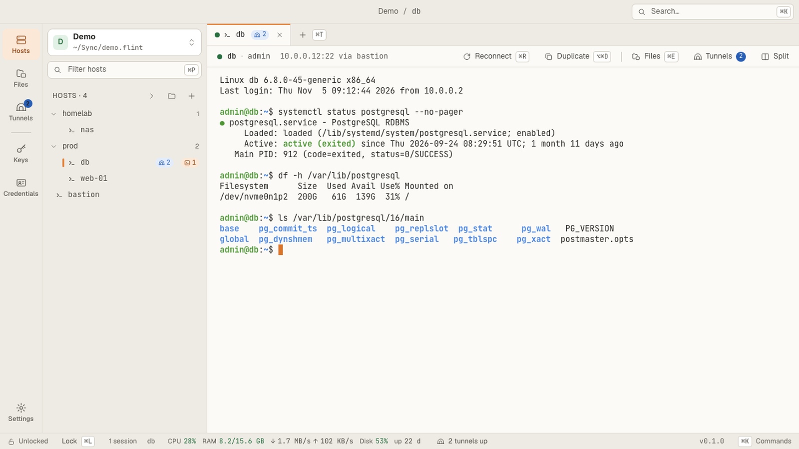

<h1 align="center">Flint</h1>

<p align="center">
  A light SSH and RDP client with a desktop app and a CLI over one fully encrypted vault.<br>
  Reach your servers by alias, from a window, a terminal or an AI agent, without exposing a credential.
</p>

<p align="center">
  
  
  
  <a href="https://github.com/gsandoval/cfire"></a>
  <br>
  
  
</p>

<picture>
  <source media="(prefers-color-scheme: dark)" srcset="site/src/assets/video/app-dark-desktop.png">
  
</picture>

> [!WARNING]
> **Preview.** Flint is in early development. Release packages for macOS, Linux and
> Windows are published, but they are not code-signed yet, and the vault format may
> still change between versions.

## Why Flint

Good SSH clients tend to be Windows only, ugly, slow, or keep sync behind a subscription.
Flint aims to be one free, fast, good-looking client for SSH and RDP on every desktop,
with nothing behind a paywall.

- **The whole vault is encrypted.** Hostnames, users, labels and known host keys too, not
  only passwords (SQLCipher, AES-256; secrets sealed again with XChaCha20-Poly1305, the key
  from Argon2id). Keep it in a cloud folder, or sync it through a server you run yourself.
- **One vault, two ways in.** The desktop app and the `flint` CLI are two front ends over
  the same core and the same file. A host added in one shows up in the other.
- **Built for scripts and AI agents.** Every command takes `--json` and has stable exit
  codes. An agent runs `flint exec web-01 -- uptime` and gets the output, never a password
  or a key, and only for what you have allowed.
- **Flint holds the unlocked vault.** The key lives in the running app, which locks on its
  own when you step away. The CLI and your agents ask it; nothing caches the key.

## What it does

| | |
|---|---|
| **Terminal** | Tabs that split into up to four panes, xterm.js with the Kitty keyboard protocol, OSC 52 copy, images pasted onto the server, a command palette, a host tree with nested groups |
| **Connections** | Password, key and agent logins, jump hosts by alias, host key verification, an initial command per host (`tmux`, `herdr`) |
| **Files** | An SFTP view beside the terminal over the same connection, and server-to-server copies with no key put on either host; `flint cp` from a script |
| **Tunnels** | Saved per host and switched on from the app or `flint tunnel up`, over the vault's login and jump host |
| **Remote desktop** | RDP hosts in a Flint tab (FreeRDP 3, H.264 on the GPU), full screen, two monitors, certificate checked like a host key |
| **Sync** | Merge a cloud folder's conflict copy record by record, or run `flint-vault-server` (Docker) and sync every machine through it; the server never sees your key |
| **Agents** | Approval prompts for programs that ask the app, scoped tokens, an activity log |
| **Updates** | A notice when a new version is out; on macOS and Windows a download checked against Flint's own Ed25519 key, applied only when you choose Relaunch |

## Install

Get the package for your system from [Releases](https://flint-2xk.pages.dev/releases/), which offers the
latest version's, or from [GitHub](https://github.com/samaniegoluis/flint/releases/latest),
with every file and its `SHA256SUMS`. Each one holds the desktop app and the `flint` CLI.

| System | Package | Good to know |
|---|---|---|
| macOS 13.3+, Apple silicon | `Flint.app`, zipped | Signed with a Developer ID and notarized from 0.38.0 |
| Windows 10 and 11, x64 | A portable folder, zipped | SmartScreen asks once (**More info** → **Run anyway**); needs the WebView2 Runtime, which Windows 11 has |
| Ubuntu 24.04+, Debian 13+, Fedora 43+ | `.deb`, `.rpm` | Installed with `apt` or `dnf`; a new version is installed the same way |

The app tells you when a new version is out; on macOS and Windows it downloads it,
checks its signature and relaunches into it when you say so, and on Linux you install
the new package as you did the first
([Updates](https://flint-2xk.pages.dev/guides/updates/)). The [install guide](https://flint-2xk.pages.dev/start/install/) has the
details, and [Build from source](https://flint-2xk.pages.dev/start/build-from-source/) the other way in.

## Quick start

With Flint installed, from a terminal (on macOS and Windows the app offers to put `flint`
on your `PATH`; the Linux packages already do):

```sh
flint vault create ~/work.flint
flint host add bastion --hostname bastion.example.com --user jump
flint host add db --hostname 10.0.0.12 --user admin --jump bastion
flint connect db
flint exec db --json -- uptime
```

## Documentation

On the docs site, [flint-2xk.pages.dev](https://flint-2xk.pages.dev/) (its pages are in
[`site/`](site/src/content/docs/) too):

- [Introduction](https://flint-2xk.pages.dev/start/introduction/) · [Install](https://flint-2xk.pages.dev/start/install/) ·
  [Build from source](https://flint-2xk.pages.dev/start/build-from-source/)
- Guides: [the desktop app](https://flint-2xk.pages.dev/guides/desktop-app/),
  [connecting](https://flint-2xk.pages.dev/guides/connecting/),
  [files](https://flint-2xk.pages.dev/guides/files-view/),
  [tunnels](https://flint-2xk.pages.dev/guides/tunnels/),
  [remote desktop](https://flint-2xk.pages.dev/guides/remote-desktop/),
  [AI agents](https://flint-2xk.pages.dev/guides/ai-agents/),
  [updates](https://flint-2xk.pages.dev/guides/updates/),
  [self-host a remote vault](https://flint-2xk.pages.dev/guides/vault-server/)
- Reference: [CLI](https://flint-2xk.pages.dev/reference/cli/),
  [security model](https://flint-2xk.pages.dev/reference/security-model/),
  [vault format](https://flint-2xk.pages.dev/reference/vault-format/)
- [Releases](https://flint-2xk.pages.dev/releases/) · [CHANGELOG](CHANGELOG.md) · [ROADMAP](ROADMAP.md)

## Built with cfire

Flint is written in [cfire](https://github.com/gsandoval/cfire), a Go-flavoured,
memory-safe language that compiles to C++23. It is also a testbed for the language:
the gaps found along the way are written down in
[`docs/cfire-upstream.md`](docs/cfire-upstream.md) for its author.

## Contributing

Flint is designed and maintained by one person. **Bug reports and ideas are very welcome**
as [issues](https://github.com/samaniegoluis/flint/issues/new/choose); pull requests are
not accepted. See [CONTRIBUTING.md](CONTRIBUTING.md) for why and how to report.

## Security

Please do not open a public issue for a vulnerability. Report it privately through
[GitHub's security advisories](https://github.com/samaniegoluis/flint/security/advisories/new);
see [SECURITY.md](SECURITY.md).

## License

[MIT](LICENSE) © Luis Samaniego.

Flint links [libssh](https://www.libssh.org) (LGPL-2.1),
[FreeRDP](https://www.freerdp.com) (Apache-2.0), [libsodium](https://libsodium.org) (ISC)
and [SQLCipher](https://www.zetetic.net/sqlcipher/) (BSD-style), and ships the
[cfire](https://github.com/gsandoval/cfire) runtime (MIT). The Windows package also
carries Microsoft's WebView2 loader, OpenSSL, libcurl and zlib. The macOS and Windows
packages hold each bundled library's licence; on Linux the libraries come from your
distribution.
